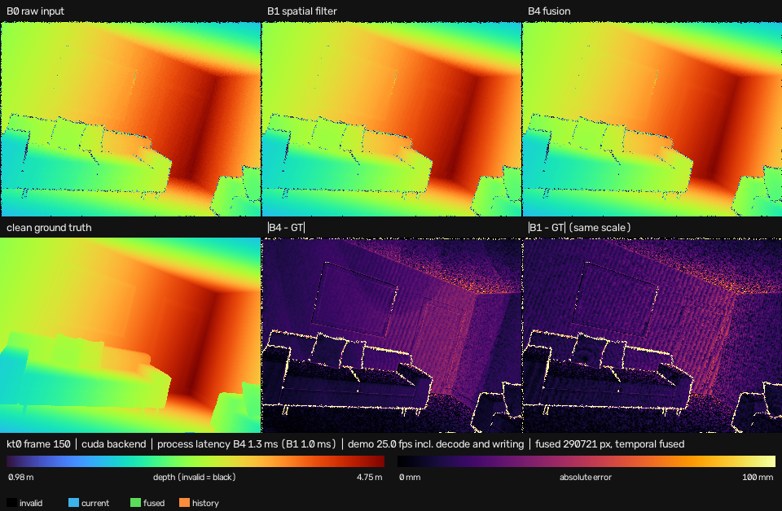

# cuDepthFusion

[](https://github.com/ahmet-f-gumustas/cuDepthFusion/actions/workflows/ci.yml)

Open-source temporal depth fusion that is aware of camera motion and preserves edges.
It combines consecutive noisy depth frames with their camera poses to produce a more
stable depth image in the current view. Old surfaces are not dragged across
occlusions or moving foregrounds. A C++ reference implementation defines
correctness, a CUDA backend makes it fast, and Python drives datasets, evaluation
and demos.

> **Status: v0.1 complete (P0–P8).** On the ICL-NUIM test split the full method cuts the p90
> error by 35 % and the bad-pixel rate by 60 % against the raw input, and a fixed world point
> is 5× steadier over time, without losing a single valid measurement. **RMSE barely moves, so
> the spec's two RMSE targets are not met**: a 2.7 % population of gross input outliers owns
> 99.4 % of the squared error, and the gate passes them through by design. On an RTX 4090
> Laptop a 640×480 frame takes 0.73 ms (median, NumPy in to NumPy out, idle GPU). Details:
> [RESULTS.md](docs/RESULTS.md), [PERFORMANCE.md](docs/PERFORMANCE.md),
> [ALGORITHM.md](docs/ALGORITHM.md), [PROGRESS.md](docs/PROGRESS.md).



**Scope.** The input is one depth image in metres, the camera intrinsics and, optionally, the
camera pose for each frame; the output is the fused depth for the current view with a validity
mask, a variance, a confidence score and the source of every pixel. The engine does not
estimate poses, does not build a map and does not fill holes unless asked to. It is a
synchronous library call, not a ROS node or a camera driver (yet; see the roadmap).

## Results

Measured on the ICL-NUIM test split (kt2 + kt3, 2120 frames) with the configuration frozen on
the validation split. The evaluator compares against the dataset's **clean depth**, which the
filter never sees, and the filter receives the dataset's **ground-truth camera poses** (oracle
poses). Poses from visual odometry or SLAM would be worse than these, and that case is not
measured here.

| Metric | B0 raw input | B1 bilateral only | B4 cuDepthFusion |
|---|---|---|---|
| p90 \|error\| | 26.00 mm | 18.39 mm | **17.02 mm** |
| bad pixels (\|e\| > max(2 cm, 1 %)) | 9.55 % | 4.11 % | **3.83 %** |
| median \|error\| | 9.00 mm | 8.34 mm | 8.43 mm |
| temporal stability, kt2 / kt3 | 10.38 / 7.25 mm | 3.44 / 2.28 mm | **1.88 / 1.40 mm** |
| RMSE | 208.1 mm | 207.8 mm | 207.7 mm |
| edge MAE | 436.6 mm | 435.1 mm | 435.1 mm |
| coverage of raw-valid pixels | 100 % | 100 % | 100 % |

Temporal stability is the standard deviation over time of the depth error at fixed world
points (median over points). All baselines, the ablation and the per-sequence numbers are in
[RESULTS.md](docs/RESULTS.md).

### Against the spec's targets

The targets were set before any number was measured. They are product goals, not results.

| Target | Measured | Verdict |
|---|---|---|
| RMSE ≥ 15 % below the raw input | 0.2 % below | **not met** |
| RMSE ≥ 5 % below the bilateral filter | 0.01 % below | **not met** |
| Edge MAE no more than 5 % worse than B1 | 435.13 vs 435.14 mm | met |
| No loss of raw-valid measurements | 100 % coverage | met |
| A clearly incompatible measurement drops the history in the same frame | synthetic tests | met |
| Process p95 ≤ 16.7 ms at 640×480 on an RTX 4070 Laptop | 0.79 ms on an RTX 4090 Laptop | **not tested** on the 4070 |

## Platforms

| Platform | What was run | Status |
|---|---|---|
| RTX 4090 Laptop (sm_89), Ubuntu 22.04, CUDA 12.8, GCC 11 | every test incl. GPU, sanitizers, evaluation, benchmark | **verified** |
| CI: Ubuntu 22.04, Python 3.10, GCC 11 | clean install, pytest, ctest (CPU) | verified on every push |
| CI: Ubuntu 24.04, Python 3.12, GCC 13 | clean install, pytest, ctest (CPU) | verified on every push |
| CI: Ubuntu 22.04, CUDA 12.8, sm_87 + sm_89 | CUDA build and tests, GPU tests SKIPPED (no device) | verified on every push |
| RTX 4070 Laptop (sm_89) | — | not yet verified (spec performance target) |
| Jetson Orin Nano Super (sm_87, aarch64) | — | not yet verified (embedded target) |

Toolchain versions and per-device checklists are in [docs/ENVIRONMENT.md](docs/ENVIRONMENT.md).

## Build and install

You need Python 3.10 or newer, CMake 3.22 or newer, and a C++17 compiler. The CUDA
build also needs the CUDA toolkit. Always use a virtual environment.

```bash
python3 -m venv .venv && source .venv/bin/activate
pip install --upgrade pip

# CPU-only
pip install -e '.[dev]'

# With CUDA (set the architecture: 89 = RTX 40xx laptop, 87 = Jetson Orin)
pip install -e '.[dev]' \
  -C cmake.define.CUDEPTHFUSION_ENABLE_CUDA=ON \
  -C cmake.define.CMAKE_CUDA_ARCHITECTURES=89
```

Use `CUDACXX=/usr/local/cuda-12.8/bin/nvcc` when `nvcc` is not on `PATH`. To get exactly the
versions this release was verified with, add `-c constraints.txt --build-constraint
constraints.txt` to the `pip install` line.

C++ library and tests without Python:

```bash
cmake -S . -B build/cpu -G Ninja
cmake --build build/cpu && ctest --test-dir build/cpu --output-on-failure

# Optional: -DCUDEPTHFUSION_ENABLE_CUDA=ON, -DCUDEPTHFUSION_SANITIZE=ON
```

## Usage

```python
import cudepthfusion as cdf

engine = cdf.DepthFusion("configs/default.yaml", backend="cpu")
result = engine.process(
    depth_m=depth_m,                    # C-contiguous float32 (H, W), metres
    intrinsics=cdf.Intrinsics(fx=481.2, fy=480.0, cx=319.5, cy=239.5),
    T_world_camera=T_world_camera,      # float64 (4, 4) camera-to-world, or None
    timestamp_s=timestamp_s,
)
result.depth_m, result.valid_mask, result.variance_m2, result.confidence_score
result.source_mask, result.history_age, result.diagnostics
```

- Invalid input is rejected, never silently converted. The engine will not copy a
  non-contiguous array or cast a float64 one for you.
- A missing pose disables the temporal stage. It is never replaced by identity
  unless you set `fusion.assume_static_camera: true`.
- `backend="cuda"` runs on the GPU when a device is present and raises
  `BackendUnavailableError` otherwise; it never falls back to the CPU.

CLI:

```bash
python -m cudepthfusion.cli info                        # build, CUDA and platform info (JSON)
python -m cudepthfusion.cli check-config configs/default.yaml
python -m cudepthfusion.cli smoke --backend cpu         # plumbing check, not a benchmark
```

## Reproduce everything

One command downloads what is missing, validates it and regenerates every published result,
the demo and the benchmark:

```bash
python scripts/reproduce.py --backend cuda --output runs/reproduce
```

It runs the documented commands below in order: download any missing ICL-NUIM sequence
(kt0–kt3, about 5 GB of archives and 11 GB on disk once extracted), `validate-data` on each,
`evaluate` on the validation split, `ablate` on it, `evaluate` on the test split with the
frozen configuration, the kt0 demo and `benchmark`. `reproduce.json` records every command,
its exit code and its duration; the first failing step stops the run. With the data already
downloaded the whole chain took 8.4 minutes on the RTX 4090 Laptop, and every validation and
test metric came out identical to the release runs.

`--backend cpu` runs it on a CPU-only build. `--frames 20` limits every step to 20 frames as a
quick pipeline check, which does not give the published numbers. `--dry-run` prints the
commands without running them.

## Evaluation

Every method is scored on the same fixed mask (clean-valid AND raw-input-valid), so nothing
improves by dropping pixels, and the clean depth is read only by the evaluator:

```bash
python -m cudepthfusion.cli evaluate --split test --data-root data/icl \
    --config configs/icl.yaml --output runs/test --backend cuda --stability --plots
python -m cudepthfusion.cli ablate --split validation --data-root data/icl \
    --config configs/icl.yaml --output runs/ablation --backend cuda
```

A run folder holds `summary.json`, `per_frame.csv`, `config_resolved.yaml`,
`environment.json` and the figures, tagged with the git commit and the dataset hashes.
Results and what they do and do not show: [docs/RESULTS.md](docs/RESULTS.md).

## Benchmark

```bash
python -m cudepthfusion.cli benchmark --config configs/benchmark.yaml --output runs/performance
```

Frames are decoded into memory before timing; each repeat resets the engine and replays the
same slice of real frames (100 warm-up, 500 measured, 5 repeats). GPU compute (CUDA events),
process latency and per-stage times are recorded separately, together with the GPU's clock,
temperature and load and whether another process was using it. Protocol and results:
[docs/PERFORMANCE.md](docs/PERFORMANCE.md).

## Demo

```bash
python examples/compare_depth.py --manifest data/icl/kt0/manifest.json \
    --config configs/icl.yaml --backend cuda --frames 200 \
    --sixth-panel error_b1 --output runs/demo/kt0 --save-video runs/demo/kt0/demo.mp4
```

All depth panels share one metre range and colormap and all error panels one millimetre
range, fixed for the whole run and recorded in `summary.json`. Process latency, demo
throughput and GPU compute are reported separately, and a time that was not measured is
`null` with its reason rather than a zero. Details: [docs/DEMO.md](docs/DEMO.md).

## Datasets

Data is downloaded on demand into the git-ignored `data/` folder and must pass validation
before the filter may read it:

```bash
python scripts/download_dataset.py --dataset icl-nuim --sequence kt0 \
    --variants clean noisy poses --output data/icl
python -m cudepthfusion.cli validate-data --manifest data/icl/kt0/manifest.json
```

Licenses and attribution are in [docs/DATASETS.md](docs/DATASETS.md). The evidence for
each dataset's conventions is in [docs/DATA_VALIDATION.md](docs/DATA_VALIDATION.md).

Analytic synthetic scenes with exact ground truth need no download:

```bash
python scripts/make_synthetic.py --suite all --output data/synthetic
```

The scenarios, conventions and the tests behind them are described in
[docs/SYNTHETIC.md](docs/SYNTHETIC.md).

## Tests

```bash
pytest              # GPU tests report SKIPPED without a CUDA build and device
pytest -m gpu       # GPU-only tests
ctest --test-dir build/cpu -L cpu

scripts/check_clean_install.sh            # install the committed tree as a new user would
scripts/check_clean_install.sh --cuda 89  # the same with CUDA
```

`check_clean_install.sh` unpacks `git archive HEAD` into a temporary directory, installs it
into a fresh virtual environment with the pinned versions and runs the smoke test, pytest and
the C++ tests there. CI runs it on every push; see [docs/ENVIRONMENT.md](docs/ENVIRONMENT.md).

## Limitations

- **The RMSE targets are not met.** 2.7 % of the pixels carry 99.4 % of the squared error.
  They are gross outliers of the input, and the gate keeps the current measurement by design,
  so they pass through. Rejecting them would move RMSE but contradict the rule that the current
  measurement is authoritative; that is an open design decision.
- **One scene, simulated noise, oracle poses.** kt0–kt3 are four trajectories through the same
  rendered living room with a simulated sensor noise model, and the filter is given the
  ground-truth poses. Nothing here shows how the method generalises to real sensors, other
  scenes or estimated poses. The pose-perturbation experiment of the spec (10.4) has not been
  run.
- **A static scene.** ICL-NUIM has no moving objects. Behaviour around moving foregrounds and
  revealed backgrounds is tested on the analytic synthetic scenes only.
- **Edges are preserved, not improved.** Edge errors stay where the input puts them.
- **One GPU measured.** Timings come from an RTX 4090 Laptop. The RTX 4070 Laptop target and
  the Jetson Orin Nano Super are untested, and no real-time guarantee is made: the numbers are
  medians and percentiles of offline runs.
- **No novelty claim.** The method combines established parts (bilateral filtering, forward
  reprojection with a z-buffer, uncertainty-gated weighted averaging). Its contribution is a
  tested, measured and reproducible implementation, not a new algorithm.

## Roadmap

| Phase | Scope | Status |
|---|---|---|
| P0 | Build, API types, CPU-only mode, config validation | done |
| P1 | ICL-NUIM downloader and adapter, manifest, geometry check | done (kt0–kt3 validated) |
| P2 | Synthetic oracle scenes | done |
| P3 | CPU bilateral filter, z-buffer reprojection, gating, fusion | done |
| P4 | CUDA kernels, CPU/GPU parity, compute-sanitizer | done |
| P5 | Baselines, metrics, ablation | done ([results](docs/RESULTS.md)) |
| P6 | Demo (PNG/MP4, side-by-side) | done ([demo](docs/DEMO.md)) |
| P7 | Profiling and optimisation | done ([performance](docs/PERFORMANCE.md)) |
| P8 | Release preparation: CI, clean-install check, one-command reproduction, citation | done |

Next, as planned in the development spec: v0.2 adds the TUM RGB-D dataset and a live camera
adapter, v0.3 a ROS 2 node and an asynchronous device API. Measurements on the RTX 4070 Laptop
and the Jetson Orin Nano Super, and the outlier-rejection decision, are open independently of
those.

## Citing

If you use cuDepthFusion, please cite it with the metadata in [CITATION.cff](CITATION.cff)
(GitHub's "Cite this repository" button reads it). Results on ICL-NUIM should also cite the
dataset; the reference is in [docs/DATASETS.md](docs/DATASETS.md).

## Contributing

See [CONTRIBUTING.md](CONTRIBUTING.md) for the setup, the checks a pull request needs and the
rules the code keeps.

## License

The code is licensed under Apache-2.0 (see [LICENSE](LICENSE)). No third-party code is
vendored: pybind11 is a build dependency, and GoogleTest is used from the system or fetched at
configure time for the C++ tests only. Datasets keep their own licenses (ICL-NUIM is CC BY 3.0)
and are never committed to this repository.
